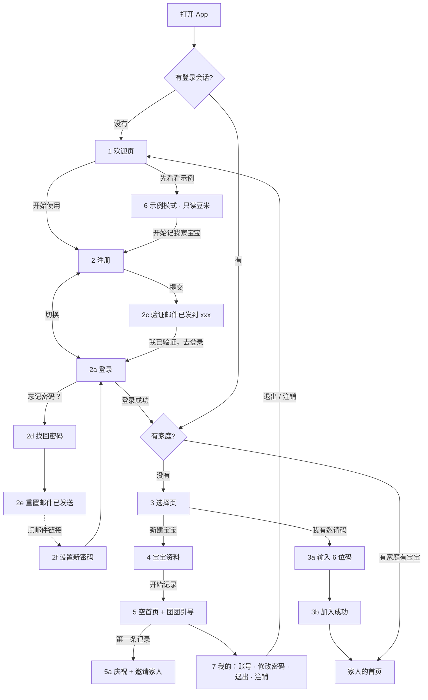

# 首次使用流程（正式版：先登录再用 + 只读示例）

> 状态：设计稿，待王康乐确认 · 分支 `docs/onboarding`
> 原型：`docs/prototype/index.html#onboarding`（从欢迎页开始），或 `#onboarding/<页面 id>` 直接跳到某页。左侧（窄屏是右侧「流程导航」按钮）可以跳到任一页。
> 不带 `#onboarding` 时原型和以前完全一样，现有的像素对比测试不受影响。

## 0. 为什么改

现在的 App 是「先在本机用，登录可选」：新用户填完资料就会看到 14 天的豆米示例记录。登录藏在「我的」里。问题有三个：

- 看到不是自己宝宝的记录，像是出错了。
- 问团子、家人同步、每户次数上限都按「家」计算。不登录这些功能都用不了。
- 只存本机的话，换手机或删 App 后数据就丢了。

正式版改成**必须登录才能记录**。不想注册的人可以从欢迎页点「先看看示例」，进一个**只读**的豆米演示，演示数据永远不写库。

## 1. 流程图

## 2. 逐页规格

页面样式全部沿用原型现有组件：

- `.full` 是整页彩色背景，带 `.bar` 返回键和标题，`.blob-bg` 是背景圆斑；
- `.card` 是白卡，`.fl` 是字段名，`.inp` 是圆角输入框（就是问团子输入框的样式）；
- `.btn.go` 是主按钮，`.segbig` 是分段切换，`.seg` 是小胶囊单选，`.cbox` 是勾选框；
- `.sheet` / `.heard` 是底部弹层，`.growcard` / `.pred` / `.note-desc` / `.pillbtn` 用于首页卡片和提示。

背景色和 RN 现有页面一致：欢迎页 yellow，登录相关 blue，验证、选择、加入成功 green，邀请码 orange，宝宝资料 pink。

| id | 页面 | 元素和文案 | 状态 / 错误 |
|---|---|---|---|
| 1 `welcome` | 欢迎页 | 团团（sprout，点头动画）；标题「团子育儿本」；价值句「一句话记下宝宝的吃睡拉，团团帮你算」；4 个亮点卡：语音一句话 / 作息预测 / 问团子 / 家人一起记；主按钮「开始使用」；文字链「先看看示例」；小字「示例是虚构的宝宝「豆米」，只能看，不会保存任何数据」；右上角夜间模式切换 | — |
| 2 `auth-up` | 注册 | 团团 flower；`.segbig` 切换「登录 / 注册」；邮箱、设置密码（至少 6 位）；勾选「我已阅读并同意《隐私政策》《用户协议》」（链接打开草案全文 sheet）；「注册后会收到一封验证邮件」 | 没勾选时按钮半透明，点了勾选框会抖一下，并 toast「请先勾选同意…」。邮箱格式错时字段变红，下方显示「邮箱格式不对，像 name@example.com 这样」。密码少于 6 位提示「密码至少 6 位」。邮箱已注册提示「这个邮箱已经注册过了，直接登录吧」 |
| 2a `auth-in` | 登录 | 团团 cap；邮箱、密码；右下「忘记密码？」；左下「登录后记录自动同步给家人」 | 提交中按钮显示「请稍候…」，团团变 listen |
| 2b `auth-err` | 登录 · 密码不对 | 顶部红色虚线 banner「邮箱或密码不对 / 再试一次，或者点「忘记密码？」用邮箱重置」，密码框变红，同时 toast | 不区分「账号不存在」和「密码错」，防止有人探测哪些邮箱注册过。邮箱没验证提示「邮箱还没验证，去邮箱点一下链接」 |
| 2c `verify` | 验证邮件已发送 | 「验证邮件已发到 xxx」；3 步说明；主按钮「我已验证，去登录」；「没收到？重新发送」（60 秒倒计时）；「邮箱填错了，换一个」 | 回到登录页时预填邮箱，绿色 banner「验证好了就登录吧」 |
| 2d `forgot` | 找回密码 | 团团 worry；「注册时用的邮箱」；按钮「发送重置邮件」 | 邮箱格式错时提示同注册页 |
| 2e `forgot-sent` | 重置邮件已发送 | 绿色 banner「重置邮件已发送 · 发到 xxx，1 小时内有效」；3 步说明；「回到登录」 | **无论邮箱是否注册都显示已发送**，防止枚举 |
| 2f `setpw` | 设置新密码 | 新密码 + 再输一次；「保存新密码」。「我的 › 修改密码」也用这一页，标题换成「修改密码」 | 「两次输入的不一样」。成功后回到登录页，banner「新密码设置好了」；从「我的」进来的就回「我的」，toast「密码改好啦」 |
| 3 `choose` | 选择页 | 绿色 banner「已登录 xxx · 还没有加入任何家庭」；团团 shy；「你是家里第一个用团子的吗？」；两张大卡：**新建宝宝**（我是家里第一个 · 创建我们家）和**我有邀请码**（家人已经在用了 · 加入家庭）；返回键等于退出登录 | 只在「登录了但不在任何家庭」时出现 |
| 3a `join` | 输入邀请码 | 6 个字符格（自动大写，过滤非字母数字，当前格粉色虚线框）；「你是宝宝的？」角色；「家人看到的记录会显示「爸爸记」」 | 不满 6 位时按钮半透明，提示「邀请码是 6 位字母和数字」。码不对时 banner 和格子变红：「邀请码不对，或者已经过期 / 被用过了」。尝试太多次提示「尝试太多次了，请一小时后再试」 |
| 3b `join-ok` | 加入成功 | 团团跳；「欢迎加入「豆米家」！」；宝宝卡（头像、名字、月龄、记录数）；家里的人（妈妈 · 管理员 / 我 · 可记录…）；「去看看豆米」直接进家人的首页 | — |
| 4 `profile` | 宝宝资料 | **空表单，不预填豆米**。宝宝昵称（≤12 字）、生日（日期选择，不晚于今天，下方实时显示「今天 3 个月 29 天」）、性别、头像（6 选 1）、喂养方式（奶粉 / 瓶喂母乳 / 亲喂）。第二张卡「你是宝宝的？」：妈妈 / 爸爸 / 奶奶 / 爷爷 / 外婆 / 外公 / 其他（选「其他」出现输入框「怎么称呼你？」≤6 字），选的就是显示名。按钮「开始记录」 | 字段下方红字：「给宝宝起个昵称吧」「选一下宝宝的生日」「生日不能晚于今天」「填一下家人怎么称呼你」。提交失败时滚到第一个错误 |
| 5 `home` | 空首页 | 真实首页布局，0 条记录。问候「你好呀！我是团团，以后 xx 的吃睡拉都交给我记～」。预测卡改成「记满 3 天 / 团团就会算」+ 0/3 天进度。6 张卡全是 0 或「—」。时间线空状态（团团睡觉）：「还没有记录哦 · 按住下面的团团说一句话，或者点卡片上的「+」」。「邀请家人一起记」提示卡可以关掉。**团团引导气泡**指向按住说话：「按住我，说一句“刚喝了 120 毫升奶”试试」，旁边有「我先自己看看」；麦克风外加粉色涟漪；引导期间隐藏「换一句」胶囊 | 团团 Lv.1 蛋壳团子 |
| 5a `home-first` | 第一条记录后 | 沿用原型的庆祝动画，文案换成「第一条记好啦！」，toast「记满 3 天，团团就能预测下一顿啦」。接着弹出 sheet「第一条记录完成！」：已完成「说一句话就能记」、下一步「记满 3 天 · 解锁作息预测」、「邀请家人 · 一起记」；按钮「继续记 / 邀请家人」 | 只在家庭第一条记录时出现一次 |
| 6 `demo` | 示例模式 | 原型现有的豆米首页，顶部固定 banner「这是示例宝宝豆米 · 只能看不能改」+ 粉色按钮「开始记我家宝宝」（进注册页）。健康、问团子（预置回答）、一键摘要都能看。「我的」页换成示例版：豆米带「示例」标签、大 CTA「开始记我家宝宝」 | 任何写操作都会被拦下，包括按住说话、卡片「+」、编辑卡片、勾选提醒、采纳建议、邀请家人。被拦时 banner 抖一下，toast「示例里只能看哦 · 点上方「开始记我家宝宝」」 |
| 7 `me` | 我的（已登录） | 宝宝资料卡、团团成长、健康档案 / 提醒 / 一键摘要；**家庭成员**（我 · 管理员 + 「邀请家人」）；数据导出、夜间模式、隐私政策；**账号**：邮箱（已验证 · 已登录）、修改密码、退出登录、注销账号（红字）。**去掉「重置演示数据」和「清空全部数据」**，「未登录」状态也不再出现 | — |
| 7a `me-logout` | 退出 / 注销确认 | 退出：「退出登录？记录都保存在云端，下次登录就能看到」→ 回欢迎页。注销分两步：第 1 步「会删除你的账号和成员身份；只有你一个人的家庭，宝宝资料和记录会一起删除」，第 2 步「真的要注销吗？注销后无法恢复。建议先导出备份」 | 和现在 RN 的两步确认一致 |
| alt `phone` | 手机号 + 验证码（备选） | +86 手机号、验证码（「获取验证码」60 秒倒计时）、同意条款；没有登录 / 注册切换（没注册过会自动注册）；底部「用邮箱登录」 | **不在当前版本**。上线手机号登录时，用它替换 2 / 2a 的表单区域，页面其他部分不变 |

所有 toast 用原型现有的 `.toast`，错误红色 `#C9452F`（夜间 `#ff9d8a`），和 RN `cloud-ui.tsx` 的 `errColor` 一致。所有页面都支持夜间模式。

## 3. 数据 / 后端对应

| 动作 | 调用 | 说明 |
|---|---|---|
| 注册 | `supabase.auth.signUp({ email, password, options: { emailRedirectTo } })` | 已有 `cloud.signUp`。返回 `confirm` 时进入 2c；`identities.length === 0` 表示已注册 |
| 登录 | `supabase.auth.signInWithPassword` | 已有 `cloud.signIn`。错误文案走 `authErrorText`，要补「Email not confirmed → 邮箱还没验证」 |
| 重新发送验证邮件 | `supabase.auth.resend({ type: 'signup', email })` | **新增**，60 秒冷却 |
| 忘记密码 | `supabase.auth.resetPasswordForEmail(email, { redirectTo })` | **新增**。原生用 `yijuji://reset`（scheme 改名后跟着改），Web 用 `origin + '/babycare/#reset'`。两个地址都要加进 Supabase Auth 的 Redirect URLs 白名单 |
| 设置新密码 | 监听 `onAuthStateChange` 的 `PASSWORD_RECOVERY` 事件 → 打开 2f → `supabase.auth.updateUser({ password })` | **新增**。「修改密码」直接调 `updateUser` |
| 有没有家庭 | `family_members` 查询（已有 `onSession → linkFamily`） | 有家庭就直接进首页，没有就进 3 |
| 新建宝宝 | `rpc('create_family', { p_name: '我们家', p_display_name: 角色 })`，然后 `babies` upsert（RLS `babies_insert` 要求是成员） | RPC 已有（`supabase/migrations/20261101000000_family_sync.sql`）。现在 `linkFamily` 上传时 upsert babies。建议写一个新 RPC `create_family_with_baby` 把两步合成一个事务（见待定 2） |
| 加入家庭 | `rpc('accept_invite', { p_code, p_display_name })` | 已有。返回 null 表示码无效 / 过期 / 已用；每小时最多试 20 次（`54000`） |
| 邀请家人 | `rpc('create_invite', { p_family })` | 已有。48 小时有效，只能用一次 |
| 注销 | `rpc('delete_account')` | 已有 |
| 示例模式 | **不调用任何后端** | 见第 5 节 |

`RELATIONS` 要加上「其他」。数据库里 `display_name` 限制在 1–12 字，自定义称呼 ≤6 字，能满足。

## 4. RN App 要改的地方

1. `src/app/_layout.tsx`：启动时的判断改成：
   - 没有会话：示例模式进 `DemoHome`，否则进欢迎页 / 认证页；
   - 有会话但没家庭：进选择页；
   - 有家庭但没宝宝：进宝宝资料；
   - 都有：进 Tabs。

   不再依赖 `settings.onboarded` 和 `consentAt`，同意记录改为注册时写入（见下面第 3 条）。
2. `src/components/onboarding.tsx`：
   - 现在的同意页拆掉，`POLICY_DRAFT` 保留，给 sheet 用；
   - 新增 `Welcome`；
   - `ProfileForm` 的 `init` 改为空宝宝，`DEFAULT_BABY()` 只给示例用；
   - 生日改成日期选择器，或者保留文本框但加日期选择；
   - 加喂养方式 `Seg` 和角色 `Rel`（含「其他」输入框）；
   - 删掉「首次使用会放入豆米的演示记录…」这行小字。
3. `src/components/cloud-ui.tsx`：
   - `LoginPage`：
     - 去掉 `onClose`；
     - banner 改为错误 / 成功提示；
     - 注册态加同意勾选，勾选后才能提交，`consentAt` 写到 `profiles` 或 auth `user_metadata`；
     - 「忘记密码？」从说明文字改成可点的链接。
   - 新增 `ForgotPage`、`ResetSentState`、`SetPasswordPage`、`VerifySentPage`。
   - `FamilySetupPage` 改成两张大卡的选择页，删掉「本机记录会上传」。
   - `JoinPage` 改成 6 格输入。
   - 新增 `JoinOkPage`。
4. `src/state/app-state.tsx`：
   - `finishOnboarding` **不再调用 `seed()`**，只负责建家庭、存宝宝、进空首页；
   - 删掉 `resetDemo` 和 `demoSeeded`；
   - 新增 `firstRecordShown`：家庭第一条记录后弹一次 5a。
5. 首页 `src/components/home.tsx`：
   - 0 条记录时显示时间线空状态和预测卡「记满 3 天」状态；`calc.ts` 记录不足 3 天时不出预测；
   - 新增引导气泡 `CoachMark`，指向 `tabbar` 的 mic，第一条记录后或点「我先自己看看」后不再显示，存到 settings；
   - 新增「邀请家人」提示卡，可关闭；家庭成员数 ≥2 时自动消失。
6. `src/app/me.tsx`：
   - 去掉「重置演示数据」「清空全部数据」和未登录的分支；
   - 账号区固定为：邮箱、修改密码、退出登录、注销账号；
   - 退出或注销后回欢迎页。
7. 示例模式：新建 `DemoRepo`（只读），数据用现有 `buildDemo()` / `buildDemoHealth()` 在内存里生成。

## 5. 示例模式绝不写库（硬规则）

- 示例模式不创建 Supabase 会话，不初始化 `cloud`，不进同步队列。`DemoRepo` 的所有写方法直接 `throw`，界面层先拦截并弹 toast。
- 语音和问团子在示例模式下**不调用 Edge Function**（不消耗百炼额度，也不占每户次数）：按住说话被拦截；问团子只用预置回答，和原型一样。
- 离开示例模式时清掉内存数据，不迁移任何示例记录到真实家庭。`isDemo(id)` 的保护继续保留，作为兜底。
- 测试：示例模式下点遍所有写入口，确认 Supabase 日志里**没有任何**请求，本地存储里也没有新增 key。

## 6. 验收标准

1. 新装 App 首屏是欢迎页。「开始使用」进注册，「先看看示例」进只读豆米。
2. 注册：
   - 没勾选同意时不能提交；
   - 邮箱格式错、密码太短、邮箱已注册都有对应提示；
   - 注册成功后显示验证页，邮箱正确，能重新发送（60 秒冷却）。
3. 登录：密码错误时显示红色 banner 和红框，文案不暴露邮箱是否存在；没验证的邮箱有专门提示。
4. 忘记密码全流程：发送 → 显示已发送（未注册的邮箱也显示已发送）→ 点邮件链接进入「设置新密码」→ 保存后能用新密码登录。原生和 Web 都要走通。
5. 第一次登录、没有家庭时进选择页：
   - 新建宝宝：资料表单是空的，必填项校验通过后进空首页，**0 条记录**；
   - 邀请码：6 格输入，有效码加入成功后直接看到家人的宝宝和记录；无效码有提示。
6. 空首页：
   - 引导气泡指向按住说话；
   - 第一条记录完成后出现庆祝和 5a sheet，引导不再出现；
   - 时间线、卡片、预测都是空状态，没有任何豆米数据。
7. 示例模式所有写入口都被拦截并弹 toast，Supabase 没有任何请求（见第 5 节）。
8. 「我的」页：
   - 没有「重置演示数据」「清空全部数据」和未登录状态；
   - 修改密码、退出、注销（两步）都能用，退出或注销后回欢迎页。
9. 视觉：新页面和 `docs/prototype/index.html#onboarding/<id>` 逐页对比，阈值和现有规则相同（`VISUAL_WARN_PCT`，默认 2%）；日间、夜间都要对比。不带 hash 的原型渲染和改动前逐像素一致（本分支已验证）。
10. 每页都没有 console error。

## 7. 待定事项

1. **手机号验证码登录**（备选页 `phone`）：
   - 国内短信要求签名经过审核，阿里云已经不给个人账号批自定义签名，用个人身份只能显示平台签名；
   - 想让短信显示「团子育儿本」，需要注册**个体户或公司**；
   - 建议和迁回国内云、ICP 备案一起做，同时决定邮箱登录是保留并存还是只留手机号。
2. **建家庭和建宝宝是否合成一个 RPC**：现在是 `create_family` 之后再 upsert `babies`，中途断网会出现「有家庭、没宝宝」，流程里会再进一次宝宝资料页兜底。合成一个 RPC 更稳，需要新的 migration。
3. **隐私政策草案要改**：第 2 条（「只保存在本机」）和第 5 条（「清空全部数据」）和登录必需的版本不一致，上线前请法务定稿。注册时要记录同意的版本号和时间。
4. **Supabase 邮件模板**：验证邮件和重置邮件要改成中文和「团子育儿本」品牌。免费版内置邮件每小时有发送上限，正式上线要接自定义 SMTP。
5. **老用户迁移**：已经在本机用过的人（有本地真实记录），升级后第一次登录、新建家庭时，是否提示「把本机 N 条记录带到新家」？现有 `linkFamily(…, true)` 支持上传。建议保留这个逻辑，但只上传非 `demo-` 记录。
6. 生日输入：原型用浏览器原生日期框，显示格式跟系统语言走；RN 端选原生日期选择器，还是保留「2026-03-28」格式的文本框，由 dsh 按依赖成本决定。
7. 「新建宝宝」后的家庭名默认是「我们家」，加入成功页显示「豆米家」（用宝宝名）。是否在建家时让用户改家庭名，可以放到 v2。
